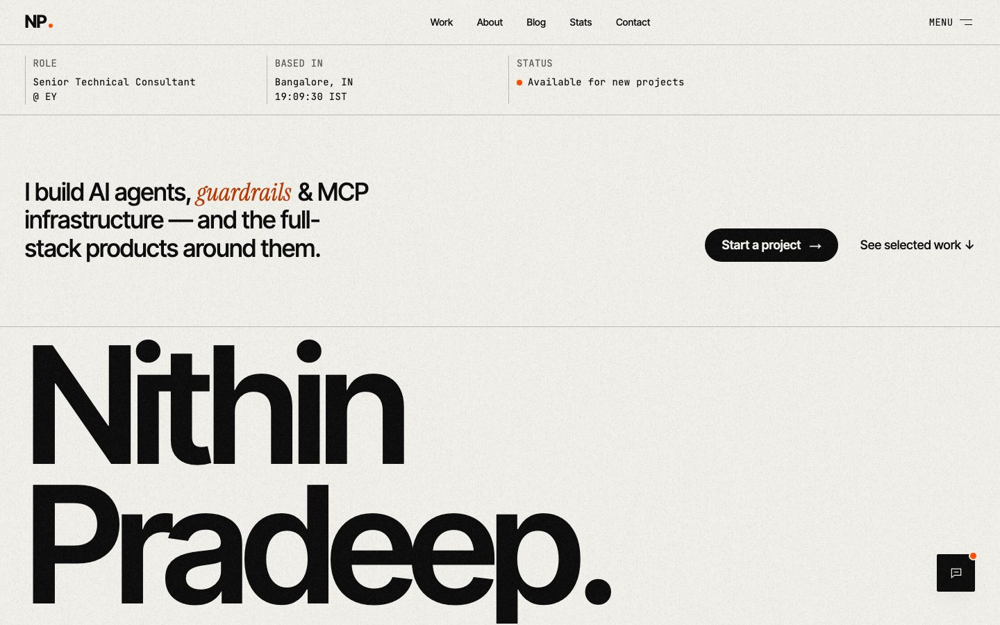
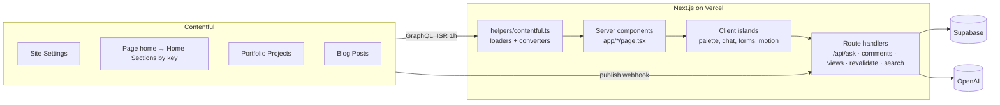

<div align="center">
  <picture>
    <source media="(prefers-color-scheme: dark)" srcset="./.github/assets/logo-dark.svg">
    <source media="(prefers-color-scheme: light)" srcset="./.github/assets/logo-light.svg">
    
  </picture>

  <h1>Nithin Pradeep — Portfolio</h1>

  <p>An editorial, Swiss-grid portfolio for an AI and full-stack engineer: case studies, a blog, live stats and an AI assistant, with all content in Contentful.</p>

  <p>
    <a href="https://portfolio-nithin.vercel.app"><strong>Live site</strong></a> ·
    <a href="#awwwards">Awwwards</a> ·
    <a href="docs/engineering/CI_CD.md">CI/CD</a> ·
    <a href="docs/cms/HOW_TO_ADD.md">Editing content</a>
  </p>

  <p>
    <a href="https://github.com/nithiin7/portfolio-nithin/actions/workflows/ci.yml"></a>
    
    
    
    
  </p>
</div>

<picture>
  <source media="(prefers-color-scheme: dark)" srcset="./.github/assets/screenshot-dark.jpg">
  
</picture>

<p align="center"><sub>Dark and light themes follow your system setting on GitHub.</sub></p>

## Awwwards

<a id="awwwards"></a>Submission pending: link to be added after the jury vote. Submission kit: [docs/redesign/AWWWARDS.md](docs/redesign/AWWWARDS.md).

## Highlights

- **Editorial Swiss design system**: one token file for colour, type scale, spacing, grid and motion, dark and light themes, a visible 12-column grid, and a root size that scales up to 4K.
- **Motion with restraint**: Motion/React reveals, a `ScrambleText` primitive for headings, a pinned manifesto, view-transition page changes and Lenis smooth scrolling. Every effect honours `prefers-reduced-motion`.
- **Case studies** with theme-matched cover plates, a reading-progress rail, a lightbox gallery and next-project transitions.
- **⌘K command palette**: search pages, posts and projects, toggle the theme, or ask an AI that answers from a RAG index of the résumé and projects.
- **Blog** with client-side filters, table of contents, code blocks, share links, view counts and moderated comments.
- **Live `/stats`**: GitHub, dev.to, WakaTime, Hugging Face and blog numbers.
- **Content in Contentful**: every section is found by its key and ordered by the CMS. Schema changes are migrations in code, linted by `pnpm cms:check`.
- **Built to be checked**: Lighthouse a11y 100, axe on every route in both themes, a Report-Only CSP, typed env validation, and around 290 unit/component tests plus a Playwright suite.

## Tech stack

| Layer     | Tools                                                                               |
| --------- | ----------------------------------------------------------------------------------- |
| Framework | Next.js 16 (App Router, RSC, Turbopack), React 19, TypeScript (strict)              |
| Styling   | SCSS Modules, CSS custom-property tokens                                            |
| Content   | Contentful (GraphQL via Apollo Client), `contentful-migration`                      |
| Data      | Supabase (comments, blog views, newsletter)                                         |
| Motion    | Motion/React, Lenis, React View Transitions                                         |
| Forms     | React Hook Form, Yup, EmailJS, reCAPTCHA v3                                         |
| AI        | OpenAI embeddings + chat (RAG over `data/knowledge`), Hugging Face Space chat embed |
| Quality   | Vitest, Testing Library, Playwright, axe, Lighthouse CI, ESLint, knip, Prettier     |
| Ops       | Vercel, GitHub Actions, Sentry, Google Tag Manager, release-please, Dependabot      |

## Architecture



Server components fetch and convert content (components never see raw Contentful shapes) and pass plain props to small client islands. Home sections are looked up by `key`, and their order comes from the CMS. Contentful's publish webhook revalidates the affected routes.

## Local setup

Requires Node 24 (`.nvmrc`) and pnpm 11 (`corepack enable`).

```bash
git clone git@github.com:nithiin7/portfolio-nithin.git && cd portfolio-nithin
pnpm install
cp .env.example .env   # fill in the Contentful variables at minimum
pnpm dev               # http://localhost:3000
```

### Environment variables

Mirrors [.env.example](.env.example). **Required** variables stop the server from starting when missing; feature variables only disable their feature.

| Variable                          | Required   | Purpose                                         |
| --------------------------------- | ---------- | ----------------------------------------------- |
| `CONTENTFUL_SPACE_ID`             | ✓          | Contentful space                                |
| `CONTENTFUL_ENVIRONMENT`          | ✓          | Environment (`master`)                          |
| `CONTENTFUL_VERSION`              | ✓          | API version (`v1`)                              |
| `CONTENTFUL_ACCESS_TOKEN`         | ✓          | Delivery API token (read-only)                  |
| `CONTENTFUL_REVALIDATE_SECRET`    |            | Webhook secret for `/api/revalidate`            |
| `CONTENTFUL_PREVIEW`              |            | `true` reads drafts                             |
| `CONTENTFUL_PREVIEW_ACCESS_TOKEN` | in preview | Preview API token                               |
| `CONTENTFUL_MANAGEMENT_TOKEN`     |            | Local CMS scripts only, never on Vercel         |
| `NEXT_PUBLIC_SUPABASE_URL`        | feature    | Comments, views, newsletter                     |
| `NEXT_PUBLIC_SUPABASE_ANON_KEY`   | feature    | Comments, views, newsletter                     |
| `NEXT_PUBLIC_RECAPTCHA_SITE_KEY`  | feature    | reCAPTCHA v3 in the browser                     |
| `RECAPTCHA_SECRET_KEY`            | feature    | Server-side reCAPTCHA verification              |
| `NEXT_PUBLIC_SERVICE_ID`          | feature    | EmailJS service (contact form)                  |
| `NEXT_PUBLIC_TEMPLATE_ID`         | feature    | EmailJS template                                |
| `NEXT_PUBLIC_EMAILJS_ID`          | feature    | EmailJS public key                              |
| `NEXT_PUBLIC_GOOGLE_GTM_ID`       |            | Google Tag Manager                              |
| `OPENAI_API_KEY`                  |            | AI answers in the command palette, `pnpm embed` |
| `WAKATIME_API_KEY`                |            | `/stats` coding activity                        |
| `HUGGINGFACE_TOKEN`               |            | `/stats` Hugging Face card                      |

## Scripts

| Command                                          | What it does                                                      |
| ------------------------------------------------ | ----------------------------------------------------------------- |
| `pnpm dev` / `build` / `start`                   | Next.js dev server, production build, production server           |
| `pnpm lint` / `lint:fix`                         | ESLint                                                            |
| `pnpm format` / `format:fix`                     | Prettier check / write                                            |
| `pnpm typecheck`                                 | `tsc --noEmit`                                                    |
| `pnpm knip`                                      | Unused files, exports and dependencies                            |
| `pnpm test` / `test:watch` / `test:coverage`     | Vitest unit and component tests (coverage has thresholds)         |
| `pnpm test:e2e`                                  | Playwright; set `PLAYWRIGHT_BASE_URL` to test a running build     |
| `pnpm generate`                                  | Plop: component, or route + page component (with SCSS and a test) |
| `pnpm analyze`                                   | Webpack bundle analyzer                                           |
| `pnpm cms:migrate` / `cms:check` / `cms:publish` | Contentful migrations, content lint, publish drafts               |
| `pnpm plates` / `plates:upload`                  | Project cover plates and their upload as drafts                   |
| `pnpm embed` / `embed:check`                     | Rebuild / verify the RAG embeddings from `data/knowledge`         |
| `pnpm icons`                                     | Regenerate app icons                                              |

## Project structure

```
├── contentful/        # migrations (NNN_*.cjs + data), cms:check rules, CMA client, seed assets
├── data/knowledge/    # Markdown the AI assistant answers from → data/embeddings.json
├── docs/              # engineering (CI/CD, audits), cms (conventions, recipes), redesign kit
├── e2e/               # Playwright: smoke, flows, axe, overflow
├── migrations/        # Supabase SQL
├── scripts/           # responsive audit, plates, icons, embeddings, Awwwards images
├── src/
│   ├── app/           # routes, route handlers, OG images, sitemap, feed, service worker
│   ├── clients/       # Apollo (server-only), Supabase, OpenAI
│   ├── components/    # layouts · motion · pages/<route> · utilities
│   ├── config/        # site constants, image crop table
│   ├── helpers/       # loaders, converters, env, API protection, formatting
│   ├── hooks/ contexts/ queries/ services/ types/
│   └── styles/        # tokens.scss (+ tokens.ts), shared mixins, globals
└── templates/         # Plop templates
```

## Deployment

Vercel builds a preview for every branch and deploys `main` to production. GitHub Actions runs lint/test/build on every PR, then Playwright, axe and Lighthouse against the Vercel preview. Releases come from release-please on `main`. See [docs/engineering/CI_CD.md](docs/engineering/CI_CD.md) for secrets, env vars and branch protection.

## Contributing

See [CONTRIBUTING.md](CONTRIBUTING.md). Security issues: [SECURITY.md](SECURITY.md).

## Credits and licence

Design and code by [Nithin Pradeep](https://github.com/nithiin7). Typefaces are served through `next/font`. Content, images and the résumé are © Nithin Pradeep; the code is [MIT](LICENSE).
