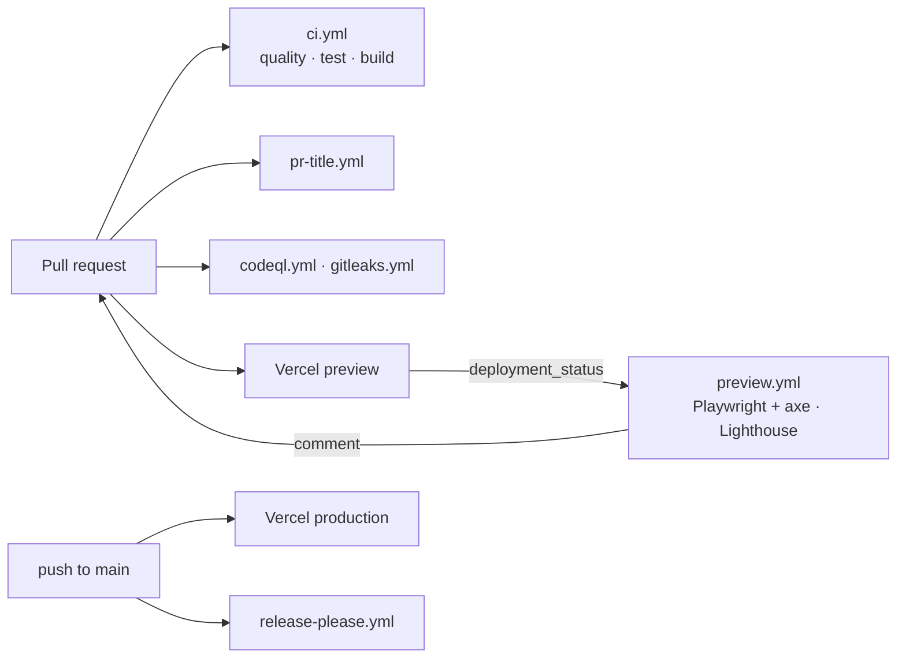

# CI/CD

GitHub Actions checks every change; Vercel builds and hosts every branch. Nothing deploys from Actions.



## Workflows

| File                 | Runs on                                              | What it does                                                                                                                                                                                                                                                                                                         |
| -------------------- | ---------------------------------------------------- | -------------------------------------------------------------------------------------------------------------------------------------------------------------------------------------------------------------------------------------------------------------------------------------------------------------------- |
| `ci.yml`             | PRs into and pushes to `main`, `dev`, `redesign`     | Three parallel jobs. **quality**: ESLint, Prettier, `tsc`, knip, embeddings check. **test**: Vitest with coverage (thresholds fail the job; summary in the job summary; HTML report as an artifact). **build**: `next build` with read-only Contentful credentials.                                                  |
| `preview.yml`        | Vercel `deployment_status: success` (not Production) | **e2e**: the full Playwright suite (smoke, flows, axe on every route in both themes, overflow at 320/1920/3840) against the preview URL; HTML report and traces uploaded on failure. **lighthouse**: Lighthouse CI on `/`, `/portfolio/orbit`, `/blog` (3 runs each), budgets enforced, results commented on the PR. |
| `pr-title.yml`       | PR opened/edited                                     | PR title must be a Conventional Commit (squash merges use it as the commit message, which release-please reads).                                                                                                                                                                                                     |
| `codeql.yml`         | PRs into `main`/`redesign`, pushes to `main`, weekly | CodeQL `security-extended` for JavaScript/TypeScript.                                                                                                                                                                                                                                                                |
| `gitleaks.yml`       | Every PR and push                                    | Secret scan of the full history. `.gitleaks.toml` allowlists the two public client identifiers (Supabase anon key, Sentry DSN key).                                                                                                                                                                                  |
| `release-please.yml` | Push to `main`                                       | Keeps a release PR open; merging it bumps `package.json`, writes `CHANGELOG.md`, tags `vX.Y.Z` and creates the GitHub release.                                                                                                                                                                                       |
| `dependabot.yml`     | Weekly (Monday)                                      | npm and GitHub Actions updates, minor + patch grouped into one PR each. Majors are ignored; they're planned upgrades.                                                                                                                                                                                                |

### Lighthouse budgets

`lighthouserc.json`: Performance ≥ 90, Accessibility = 100, Best practices ≥ 95, SEO = 100, on the **desktop** preset.

- Desktop because shared GitHub runners make mobile (4× CPU throttle) Performance swing ±10 between runs, so a mobile ≥ 90 gate would fail on noise rather than regressions. Mobile is still measured in the release checklist.
- `is-crawlable` is skipped: Vercel previews send `X-Robots-Tag: noindex`, which would otherwise fail SEO on every preview. Production is crawlable.

### Releases: release-please (replaces standard-version)

`standard-version` is deprecated upstream, ran only on a laptop, and pulled the Handlebars critical advisories into the tree. release-please runs in Actions from the same Conventional Commits, so a release is "merge the release PR" with no local tooling, and the changelog keeps the same sections. The first release after launch is forced to 5.0.0 with a `Release-As: 5.0.0` footer (see LAUNCH_CHECKLIST.md).

## Required GitHub secrets

Settings → Secrets and variables → Actions.

| Secret                            | Used by                | Value                                                                                                                      |
| --------------------------------- | ---------------------- | -------------------------------------------------------------------------------------------------------------------------- |
| `CONTENTFUL_SPACE_ID`             | ci.yml build           | Space ID                                                                                                                   |
| `CONTENTFUL_ENVIRONMENT`          | ci.yml build           | `master`                                                                                                                   |
| `CONTENTFUL_VERSION`              | ci.yml build           | `v1`                                                                                                                       |
| `CONTENTFUL_ACCESS_TOKEN`         | ci.yml build           | A **Delivery API** token (read-only, published content). Create a dedicated "GitHub CI" API key for it.                    |
| `NEXT_PUBLIC_SUPABASE_URL`        | ci.yml build           | Supabase project URL                                                                                                       |
| `NEXT_PUBLIC_SUPABASE_ANON_KEY`   | ci.yml build           | Supabase anon key                                                                                                          |
| `NEXT_PUBLIC_RECAPTCHA_SITE_KEY`  | ci.yml build           | reCAPTCHA v3 site key                                                                                                      |
| `VERCEL_AUTOMATION_BYPASS_SECRET` | preview.yml (optional) | Only if Vercel Deployment Protection is on: Project → Settings → Deployment Protection → Protection Bypass for Automation. |

`GITHUB_TOKEN` is provided automatically. Without the Contentful secrets (forks, new clones) the build job logs a notice and passes.

## Vercel environment variables

Project → Settings → Environment Variables. Names match `.env.example`.

| Variable                                                                                         | Production | Preview   | Notes                                                        |
| ------------------------------------------------------------------------------------------------ | ---------- | --------- | ------------------------------------------------------------ |
| `CONTENTFUL_SPACE_ID`, `CONTENTFUL_ENVIRONMENT`, `CONTENTFUL_VERSION`, `CONTENTFUL_ACCESS_TOKEN` | ✓          | ✓         | The server won't start without these (`assertEnv`)           |
| `CONTENTFUL_REVALIDATE_SECRET`                                                                   | ✓          | –         | Shared with the Contentful webhook                           |
| `CONTENTFUL_PREVIEW`, `CONTENTFUL_PREVIEW_ACCESS_TOKEN`                                          | **unset**  | optional  | Set both on Preview to review drafts                         |
| `NEXT_PUBLIC_SUPABASE_URL`, `NEXT_PUBLIC_SUPABASE_ANON_KEY`                                      | ✓          | ✓         | Comments, views, newsletter                                  |
| `NEXT_PUBLIC_RECAPTCHA_SITE_KEY`, `RECAPTCHA_SECRET_KEY`                                         | ✓          | ✓         | Without the secret, comments fail verification               |
| `NEXT_PUBLIC_SERVICE_ID`, `NEXT_PUBLIC_TEMPLATE_ID`, `NEXT_PUBLIC_EMAILJS_ID`                    | ✓          | ✓         | Contact form                                                 |
| `NEXT_PUBLIC_GOOGLE_GTM_ID`                                                                      | ✓          | –         | Leave unset on Preview to keep test traffic out of analytics |
| `OPENAI_API_KEY`                                                                                 | ✓          | optional  | `/api/ask` answers 503 without it                            |
| `WAKATIME_API_KEY`, `HUGGINGFACE_TOKEN`                                                          | ✓          | optional  | `/stats` cards hide without them                             |
| `CONTENTFUL_MANAGEMENT_TOKEN`                                                                    | **never**  | **never** | Local CMS scripts only                                       |

## Branch protection (set by hand)

Settings → Branches → Add rule for **`main`** (and the same for `redesign` until launch):

- Require a pull request before merging; 0 approvals is fine for a solo repo, but dismiss stale approvals if you add reviewers.
- Require status checks to pass, and require branches to be up to date. Required checks:
  - `Lint, format, typecheck, knip`
  - `Unit and component tests`
  - `Production build`
  - `Conventional Commits title`
  - `gitleaks`
  - `Analyze (JavaScript/TypeScript)`
  - `E2E and a11y (Playwright)` and `Lighthouse budgets` (they appear after the first preview deployment reports back)
- Require linear history (squash or rebase merges only). Under Settings → General → Pull Requests, allow only **Squash merging**, defaulting to the PR title.
- Do not allow force pushes. Do not allow deletions.
- Include administrators, so the rules apply to you too.

Also: Settings → Code security → enable Dependabot alerts, Dependabot security updates and secret scanning push protection.

## Running the same checks locally

```bash
pnpm lint && pnpm format && pnpm typecheck && pnpm knip
pnpm test:coverage
pnpm build && pnpm start -p 3200 &
PLAYWRIGHT_BASE_URL=http://localhost:3200 pnpm test:e2e
```
